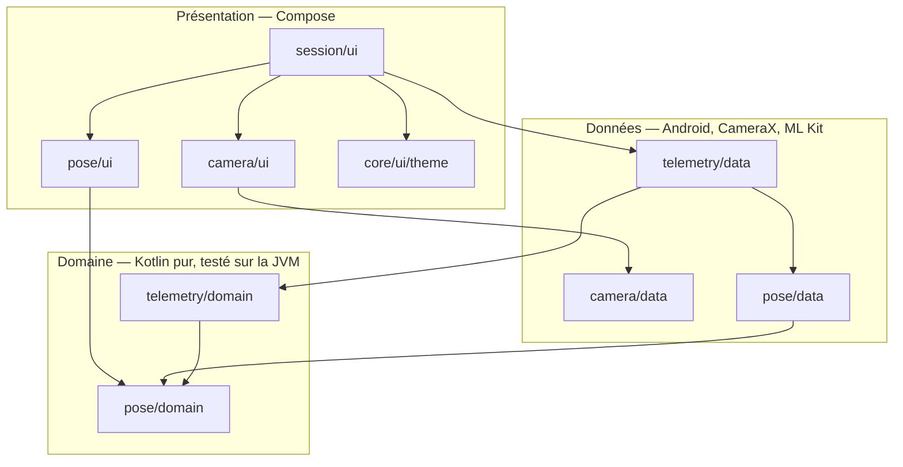

# BodyVision — application mobile

Application Android qui analyse la posture pendant les exercices de musculation. La détection de
pose s'exécute **sur le téléphone** ; seules les coordonnées articulaires sont destinées au Cloud,
en différé. Aucune vidéo ne quitte l'appareil.

La vision du projet, l'équipe, l'architecture d'ensemble et le planning vivent dans le
[README de l'organisation](https://github.com/BodyVision-CCM). Ce fichier décrit **l'état présent de
ce dépôt** : ce qu'on peut compiler, lancer et observer aujourd'hui. L'historique des décisions est
dans [`docs/`](docs/).

## Ce que fait l'application aujourd'hui

- Aperçu caméra plein écran, avec gestion de l'autorisation et des pannes de caméra.
- **Détection de pose sur le téléphone**, hors ligne, par ML Kit — 33 points du corps par image.
- **Squelette filaire en surimpression** sur l'aperçu, juste en portrait comme en paysage.
- **Bascule caméra arrière / frontale**, avec le miroir à l'affichage seulement : les coordonnées
  restent dans le repère de l'image.
- Deux compteurs à l'écran : images analysées par seconde, et nombre de points de la dernière pose.
- **Enregistrement d'une série**, sous-échantillonnée à 10 images par seconde, encodée en JSON
  conforme au schéma `SeriesUpload` du contrat, et écrite dans un **fichier local**.

## Ce qu'elle ne fait pas encore

- **Aucun réseau.** Pas d'envoi, pas de compression gzip, pas de file d'attente hors ligne : c'est
  le sprint S6.
- **Aucune alerte de posture.** Les angles ne sont ni calculés ni affichés
  ([SCRUM-64](https://bodyvision.atlassian.net/browse/SCRUM-64)).
- **Aucun compte utilisateur**, aucune base de données locale.
- **Aucune image, aucune vidéo** n'est écrite sur le disque ni envoyée. Seulement des coordonnées.

### Sur les permissions, précisément

Le code de l'application ne déclare que **`CAMERA`** (`app/src/main/AndroidManifest.xml`), et c'est
la seule permission demandée à l'utilisateur. Mais le **manifeste fusionné** en contient six autres,
apportées par les bibliothèques :

| Permission | Ajoutée par |
|---|---|
| `INTERNET`, `ACCESS_NETWORK_STATE` | `com.google.mlkit:pose-detection-common` |
| `WAKE_LOCK`, `RECEIVE_BOOT_COMPLETED`, `FOREGROUND_SERVICE` | `androidx.work:work-runtime`, dépendance transitive de ML Kit |
| `<applicationId>.DYNAMIC_RECEIVER_NOT_EXPORTED_PERMISSION` | `androidx.core:core` |

La provenance se relit dans `app/build/outputs/logs/manifest-merger-debug-report.txt`, et la liste
complète dans `app/build/intermediates/merged_manifest/debug/processDebugMainManifest/AndroidManifest.xml`,
après `.\gradlew.bat :app:processDebugMainManifest`.

**Ce dépôt ne dit pas ce que les bibliothèques font de ces permissions** : il n'en a pas la source.
Ce qu'il peut affirmer de son propre code, en revanche : il n'a **aucun client réseau** — aucune
dépendance HTTP déclarée dans `gradle/libs.versions.toml` — et l'image de la caméra ne quitte jamais
la mémoire. L'`ImageProxy` est passé à ML Kit puis **fermé sur les trois chemins**, sans jamais être
copié ni écrit (`pose/data/MlKitPoseSource.kt`). Rien d'autre que des coordonnées n'est écrit, et
seulement dans le dossier de l'application.

## Prérequis

- **JDK 17.** C'est la version utilisée par la chaîne d'intégration continue
  (`.github/workflows/ci.yml`). À ne pas confondre avec la cible de compilation du projet, qui est
  le bytecode **Java 11** (`app/build.gradle.kts`).
- **Android Studio** récent, ou le SDK Android seul si vous ne construisez qu'en ligne de commande.
- **Un appareil Android physique**, avec le débogage USB activé. `minSdk 24`, `targetSdk 36`.
- **Pas d'émulateur.** Il n'a ni vraie caméra, ni le bon GPU, ni la gestion thermique d'un
  téléphone : un essai sur émulateur ne prouve rien pour ce projet.
- Appareil de référence de toutes les mesures citées ici : **Honor 400 (DNY-NX9), Android 16**.

## Compiler, tester, installer

PowerShell, qui est l'environnement de l'équipe :

```powershell
.\gradlew.bat build          # compilation
.\gradlew.bat test           # tests unitaires JVM
.\gradlew.bat lint           # lint Android
.\gradlew.bat ktlintCheck    # style Kotlin
.\gradlew.bat installDebug   # déploiement sur l'appareil connecté
```

bash :

```bash
./gradlew build
./gradlew test
./gradlew lint
./gradlew ktlintCheck
./gradlew installDebug
```

La porte complète, celle qui doit être verte avant une pull request :

```powershell
.\gradlew.bat clean build test lint --rerun-tasks
.\gradlew.bat ktlintCheck --rerun-tasks
```

**`--rerun-tasks` n'est pas une précaution de style.** Une tâche servie `UP-TO-DATE` laisse le
rapport précédent sur le disque : on lit alors un compte périmé, sans aucun signe que c'en est un.
Pour un compte réel après un changement de configuration, forcer l'exécution.

**Le critère est `0 errors`, pas zéro avertissement.** Le lint rapporte 12 avertissements, tous
portant sur la chaîne d'outils volontairement figée jusqu'après le jalon 1 : `GradleDependency`,
`AndroidGradlePluginVersion`, `OldTargetApi` et `NewerVersionAvailable`. Ce n'est pas une liste de
tâches ; la montée de version viendra par un ticket dédié. Les raisons sont dans
[`CLAUDE.md`](CLAUDE.md).

Si `adb` n'est pas dans le `PATH`, on peut l'appeler depuis le SDK sans écrire de chemin propre à
une machine :

```powershell
& "$env:LOCALAPPDATA\Android\Sdk\platform-tools\adb.exe" devices -l
```

```bash
"$ANDROID_HOME/platform-tools/adb" devices -l
```

## Utiliser l'application

1. **Au premier lancement**, l'application demande l'autorisation d'accès à la caméra — la seule
   permission demandée à l'utilisateur, voir [ci-dessus](#sur-les-permissions-précisément). Refusée,
   l'écran explique à quoi elle sert et propose « Réessayer » ou « Ouvrir les réglages ».
2. **Le squelette** se dessine sur l'aperçu dès qu'une personne est détectée. Les compteurs en bas
   à gauche affichent le débit d'analyse et le nombre de points — 33 quand quelqu'un est dans le
   cadre, 0 sinon.
3. **Changer d'objectif** : le bouton en bas à droite nomme l'objectif vers lequel on va, donc
   « Caméra frontale » ou « Caméra arrière ».
4. **Enregistrer une série** : le bouton central « Démarrer ». Pendant l'enregistrement, un
   indicateur « ● Enregistrement » reste visible en haut à gauche et le bouton devient « Arrêter ».

**Ce qui termine une série**, d'après la
[décision écrite dans le plan du S4](docs/plan-s4.md#décisions-qui-viennent-de-toi-1) :

- le bouton « **Arrêter** » ;
- la **900ᵉ image gardée**, qui est la limite du contrat — environ 90 secondes ;
- **toute discontinuité du flux de la caméra**, parce qu'une série est une fenêtre continue d'un
  seul repère d'image : liaison défaite (bascule d'objectif, quart de tour, sortie de l'écran),
  passage en arrière-plan, reprise après une caméra occupée, et **demi-tour** de l'appareil ;
- en dernier garde-fou, une image dont la **taille redressée** diffère de celle de la série.

Dans tous ces cas le fichier est écrit, et l'indicateur disparaît de lui-même.

## Récupérer une série

Les fichiers sont dans le stockage propre à l'application, nommés par leur identifiant de lot :

```
/sdcard/Android/data/fr.upjv.bodyvision/files/telemetry/<batchId>.json
```

```bash
adb shell ls -l /sdcard/Android/data/fr.upjv.bodyvision/files/telemetry
adb pull /sdcard/Android/data/fr.upjv.bodyvision/files/telemetry/<batchId>.json .
```

Le journal donne le chemin complet, le nombre d'images gardées, le nombre d'images écartées et la
taille du fichier :

```bash
adb logcat -s TelemetryRecording
```

Deux pièges relevés pendant la séance de mesure du 17/11/2026 :

- **`run-as` ne sert à rien pour ce dossier.** `adb shell ls …` y accède directement, là où
  `run-as` se fait refuser l'accès au stockage externe.
- **Le tampon de `logcat` est trop petit par défaut** (256 Ko) : le système émet deux lignes par
  image affichée et chasse la ligne qu'on cherche. `adb logcat -G 16M` avant de mesurer.

## Format du fichier

Un fichier = **une série** = un objet `SeriesUpload`. Chaque image y porte son décalage `t` en
millisecondes depuis la première image gardée, et ses **33 points** dans l'ordre des indices ML Kit,
chacun sous la forme `[x, y, z, v]` à trois décimales. Le champ `contractVersion` vaut `1.0` : c'est
la version du **format de télémétrie**, distincte de celle du document OpenAPI.

Le schéma fait foi dans
[`bodyvision-contracts`](https://github.com/BodyVision-CCM/bodyvision-contracts/blob/main/openapi.yaml),
branche `main`, schémas `SeriesUpload` et `Frame`. Il n'est pas recopié ici : une copie locale
périme en silence.

Extrait **tronqué** de l'oracle du test `SeriesUploadJsonTest`, pour la forme seulement :

```json
{"batchId":"…","index":0,"exerciseCode":"SQUAT","startedAt":"…","endedAt":"…",
"contractVersion":"1.0","capture":{"landmarkSet":"MLKIT_POSE_33","model":"BASE",
"analysisWidth":640,"analysisHeight":480,"nominalFps":10},
"frames":[{"t":0,"lm":[[0.100,0.200,-0.300,0.900], … 33 points en tout … ]}]}
```

Le vrai fichier est sur une seule ligne. `analysisWidth` et `analysisHeight` portent la taille de
l'image **redressée**, donc 480x640 quand le téléphone est tenu en portrait : voir les
[limites connues](docs/plan-s4.md#limites-connues-1).

## Organisation du code

Découpage **par fonctionnalité**, avec les couches à l'intérieur de chaque fonctionnalité. Les
dépendances pointent toujours vers le **domaine**, qui ne connaît ni Android, ni CameraX, ni ML Kit
— c'est ce qui le rend testable sur la JVM, sans appareil.

| Dossier | Rôle |
|---|---|
| `camera/` | Liaison CameraX, objectifs, rotation de l'analyse, aperçu. |
| `pose/` | Les 33 points : domaine, frontière ML Kit, projection et overlay. |
| `session/` | L'écran de captation, qui assemble les autres et décide de l'état affiché. |
| `telemetry/` | Accumulateur de série, encodeur JSON, écriture du fichier. |
| `core/` | Le thème, sombre uniquement. |



Pas d'arborescence fichier par fichier ici : elle se périmerait au premier ticket.

## Performances mesurées

Toute mesure **exclut les 30 premières secondes** : l'accélération matérielle de ML Kit est choisie
de façon non bloquante, et les premières exécutions tournent sur le processeur. C'est une règle du
projet, écrite dans [`CLAUDE.md`](CLAUDE.md).

| Mesure | Valeur | Quand, et où elle est écrite |
|---|---|---|
| Configuration ML Kit figée | modèle de base, `CPU_GPU`, analyse 640x480, `STREAM_MODE` | [`CLAUDE.md`](CLAUDE.md), décision issue du spike SCRUM-22 |
| Débit d'inférence | **29,4 images/s**, latence médiane **26,4 ms**, stable sur 10 minutes | SCRUM-22, sur le Honor 400 — [`CLAUDE.md`](CLAUDE.md) |
| Entrée observée pendant un enregistrement | **23,5 images/s** | [séance du 17/11/2026](docs/plan-s4.md#vérification-sur-appareil--séance-du-17112026) |
| Débit retenu dans le fichier | **9,99 images/s** sur 25 s, **10,00** sur 90 s | idem |
| Série de 10 squats | 252 images, 225 Ko, **0 image écartée** | idem |
| Série pleine | **900 images**, 89,913 s, 793 Ko | idem |
| Poids par image | 894 à 903 octets, soit ≈ 268 Ko pour 300 images | idem |

**Ce qui n'est pas mesuré, et qu'il ne faut donc pas citer** : le débit du flux live dans
l'application elle-même. Le critère de SCRUM-32 était « ≥ 24 images par seconde en continu »
([`docs/plan-s3.md`](docs/plan-s3.md)) et il a été constaté à l'écran, mais aucun relevé n'a été
consigné depuis le spike. Les 29,4 images/s ci-dessus viennent du spike, pas de l'application.
L'optimisation du débit est le sujet de
[SCRUM-41](https://bodyvision.atlassian.net/browse/SCRUM-41), au sprint S5.

## Limites connues

Une ligne chacune ; l'explication est dans le plan, pas ici.

- **Rotation automatique coupée et appareil tourné** : les coordonnées sont dans le repère de
  l'écran et non dans celui de la gravité. Sans effet sur un angle entre deux segments, faux pour
  une inclinaison mesurée par rapport à la verticale →
  [limites de SCRUM-36](docs/plan-s4.md#limites-connues),
  [SCRUM-113](https://bodyvision.atlassian.net/browse/SCRUM-113).
- **Appareils pliables** forcés en `TextureView` par CameraX : l'aperçu peut rester figé sur une
  rotation → [limites de SCRUM-36](docs/plan-s4.md#limites-connues).
- **Quitter l'application pendant un enregistrement** : corrigé, le fichier est écrit ; reste le cas
  d'une mort du processus → [limites de SCRUM-37](docs/plan-s4.md#limites-connues-1).
- **Le fichier n'est pas une requête** : `uploadSeries` exige un identifiant de séance, qui n'existe
  pas avant le S6 → [limites de SCRUM-37](docs/plan-s4.md#limites-connues-1).
- **Une seule série par enregistrement**, donc `index` vaut toujours 0 →
  [limites de SCRUM-37](docs/plan-s4.md#limites-connues-1).
- **`capture.analysisWidth` et `analysisHeight`** portent la taille redressée, donc 480x640 en
  portrait : ambiguïté du contrat, question posée à son propriétaire →
  [limites de SCRUM-37](docs/plan-s4.md#limites-connues-1).
- **`endedAt` est calculé et arrive en retard** : la durée de la série est exacte, son placement
  absolu non → [limites de SCRUM-37](docs/plan-s4.md#limites-connues-1).

## Documentation

| Document | Contenu |
|---|---|
| [`docs/demo-jalon-1.md`](docs/demo-jalon-1.md) | Le scénario de la démonstration du jalon 1, reproductible. |
| [`docs/plan-s4.md`](docs/plan-s4.md) | Sprint S4 : squelette en surimpression, extraction du JSON, mesures sur appareil. |
| [`docs/plan-s3.md`](docs/plan-s3.md) | Sprint S3 : initialisation, CameraX et permissions, détection en flux live. |
| [`CLAUDE.md`](CLAUDE.md) | Les décisions figées de ce dépôt et les pièges propres au projet. |
| [Contrat OpenAPI](https://github.com/BodyVision-CCM/bodyvision-contracts) | La source de vérité des interfaces. Branche `main`. |
| [README de l'organisation](https://github.com/BodyVision-CCM) | Vision, équipe, architecture d'ensemble, planning et jalons. |
| [Page des décisions](https://bodyvision.atlassian.net/wiki/spaces/BV/pages/11206657) | Les décisions d'équipe, sur Confluence. |

## Contribuer

- **Une branche par ticket** : `feat/scrum-NN-description-courte`.
- **Messages de commit en français**, format court et sans portée : `feat:`, `fix:`, `refactor:`,
  `docs:`, `test:`, avec le numéro de ticket dans le corps.
- **Une pull request vers `main`**, fusionnée en **squash**, avec une relecture obligatoire. `main`
  est protégée : pas de commit direct. Le modèle de description est celui de l'organisation,
  [`PULL_REQUEST_TEMPLATE.md`](https://github.com/BodyVision-CCM/.github/blob/main/PULL_REQUEST_TEMPLATE.md).
- **La chaîne d'intégration continue** (`.github/workflows/ci.yml`) lance
  `clean build test lint --rerun-tasks` sur chaque pull request — ktlint s'exécute avec, parce que
  son greffon s'accroche à la tâche `check`. Elle mesure aussi la mémoire du build et scanne le
  dépôt avec Trivy.

---

<sub>Projet académique — UE Projet Thématique, M2 Cloud Computing &amp; Mobility, INSSET.</sub>
