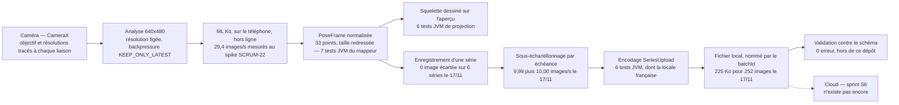
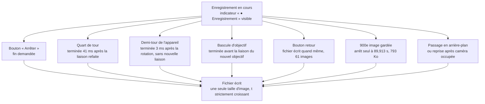

# Démonstration du jalon 1 — PoC technique

**Date : 17/11/2026.** Appareil : Honor 400 (DNY-NX9), Android 16, physique.

Objectif du jalon, tel qu'il est écrit dans le [README de l'organisation](https://github.com/BodyVision-CCM) :

> Squelette filaire affiché en temps réel sur le téléphone, et extraction du JSON de télémétrie

**Il n'y a pas de vidéo de démonstration : la démonstration, c'est ce document.** Il est écrit pour
être rejoué par quelqu'un d'autre — chaque geste indique ce qu'on doit voir, et chaque ordre de
grandeur renvoie à la mesure qui l'a produit. Les chiffres cités sont **des relevés, pas des
garanties** : ils dépendent de la lumière, de la chauffe de l'appareil et du cadrage.

## La chaîne, de la caméra au fichier validé



Lecture : une seule branche descend de la caméra au fichier validé ; l'overlay part en parallèle
depuis la même `PoseFrame`, donc l'affichage et l'enregistrement décrivent exactement la même image.
La flèche en pointillés vers « Cloud » est le périmètre du S6 : rien de ce côté n'existe aujourd'hui.

## Préparation

1. **Appareil chargé** et branché en USB, débogage activé.
2. **Rotation automatique activée** dans les réglages du système. Plusieurs gestes en dépendent.
3. **Cadrage trois-quarts, à deux ou trois mètres.** C'est le cadrage sous lequel tous les chiffres
   cités ici ont été relevés ([séance du 17/11](plan-s4.md#vérification-sur-appareil--séance-du-17112026)) :
   le reproduire est la condition pour retrouver les mêmes ordres de grandeur.
4. **Agrandir le tampon de journal** avant de commencer, sinon les lignes utiles sont chassées par
   celles du système :
   ```bash
   adb logcat -G 16M
   ```
5. **Laisser passer 30 secondes** après le lancement avant de regarder le compteur d'images par
   seconde : l'accélération matérielle de ML Kit est choisie de façon non bloquante et les premières
   exécutions tournent sur le processeur.

Pendant toute la démonstration, garder une fenêtre sur le journal :

```bash
adb logcat -s TelemetryRecording CameraSessionBinder
```

## Les gestes, dans l'ordre

### 1. Lancement et autorisation

Installer et lancer :

```powershell
.\gradlew.bat installDebug
```

**Ce qu'on doit voir** : la demande d'autorisation d'accès à la caméra, puis l'aperçu plein écran.
C'est la seule permission demandée **à l'utilisateur** ; le manifeste fusionné en déclare six autres,
apportées par les bibliothèques, et le [README](../README.md#sur-les-permissions-précisément) dit
lesquelles et par qui. Si on refuse, l'écran explique à quoi la caméra sert et propose
« Réessayer » — ce chemin vaut la peine d'être montré, c'est celui d'un utilisateur méfiant.

### 2. Le squelette, en portrait puis en paysage

Se placer dans le cadre. **Ce qu'on doit voir** : le squelette filaire posé sur le corps, mains et
pieds compris même près des bords, et les deux compteurs en bas à gauche qui affichent le débit
d'analyse et **33 points**. En tournant l'appareil en paysage, le squelette doit rester posé sur le
corps : c'est le critère d'acceptation de SCRUM-36, et la projection est recalculée pour la nouvelle
taille d'image.

Ce qui serait un échec : un squelette décalé de 90° par rapport au corps.

### 3. Bascule vers la caméra frontale

Appuyer sur le bouton en bas à droite, qui nomme l'objectif vers lequel on va.

**Ce qu'on doit voir** : l'aperçu passe en miroir, et le squelette suit le miroir. Surtout, **aucune
pose de l'ancien objectif** ne doit apparaître une fraction de seconde sur le nouvel aperçu. Le
journal trace une ligne par liaison, avec l'objectif et les deux résolutions.

### 4. Enregistrer une série de 10 squats

Vérifier d'abord que le compteur affiche **33 points** — sans quoi la série sortirait vide. Puis
« Démarrer », dix squats, « Arrêter ».

**Ce qu'on doit voir** : l'indicateur « ● Enregistrement » pendant toute la série, le bouton qui
devient « Arrêter », et une ligne de journal à la fin. Ordres de grandeur relevés le 17/11 pour
~25 secondes de mouvement : **252 images gardées, 0 écartée, 225 Ko**, soit un peu moins de
10 images par seconde. Le nombre d'images **écartées** est le chiffre à surveiller : il doit rester
proche de zéro, et au-dessus de 1 % il faut s'arrêter et comprendre pourquoi.

### 5. Récupérer le fichier

```bash
adb shell ls -l /sdcard/Android/data/fr.upjv.bodyvision/files/telemetry
adb pull /sdcard/Android/data/fr.upjv.bodyvision/files/telemetry/<batchId>.json .
```

Le `batchId` est dans la ligne de journal. `run-as` est inutile ici : `adb shell` accède au dossier
directement.

### 6. Une série interrompue par une rotation

Démarrer un enregistrement, rester dans le cadre deux ou trois secondes, puis **tourner l'appareil
d'un quart de tour sans appuyer sur « Arrêter »**.

**Ce qu'on doit voir** : la série se termine d'elle-même, son fichier est écrit, l'indicateur
disparaît et le bouton revient sur « Démarrer » sans qu'on y touche. Le fichier ne contient qu'une
seule taille d'image. Relevé le 17/11 : série terminée **41 ms** après la liaison refaite,
`capture` à **480x640 seul**, 0 image écartée.

C'est la démonstration la plus parlante du document : elle montre qu'un fichier de télémétrie ne
mélange jamais deux repères.

## Ce qui termine une série



Lecture : sept événements terminent une série, et **tous mènent au même endroit** — un fichier
écrit, portant une seule taille d'image et des horodatages strictement croissants. Les résultats en
étiquette sont ceux relevés le 17/11 ; le demi-tour et le bouton retour ont été éprouvés en
injectant la panne inverse, pour vérifier que la barrière servait à quelque chose. Détail dans la
[séance du 17/11](plan-s4.md#vérification-sur-appareil--séance-du-17112026).

## Valider le fichier contre `SeriesUpload`

La validation se fait **en dehors de ce dépôt**, contre le schéma `SeriesUpload` de
[`bodyvision-contracts`](https://github.com/BodyVision-CCM/bodyvision-contracts/blob/main/openapi.yaml),
branche `main`. Aucun script ni aucune dépendance n'est ajouté ici pour ça : le contrat est la source
de vérité, et c'est lui qui valide, pas nous.

Ce qu'on contrôle sur le fichier récupéré :

| Contrôle | Attendu |
|---|---|
| `lm` | exactement **33 points** par image, chacun à 4 nombres |
| `t` | **entier**, part de **0**, **strictement croissant** |
| Débit | environ **10 images par seconde** sur la durée de la série |
| Nombres | **point décimal**, jamais de virgule, trois décimales |
| `contractVersion` | `"1.0"` — la version du **format**, pas celle du document OpenAPI |
| `capture` | `landmarkSet`, `model`, `analysisWidth`, `analysisHeight`, `nominalFps` renseignés |
| `frames` | au plus **900** |

Le fichier produit est un **corps de requête** valide, pas une requête : `uploadSeries` exige un
identifiant de séance, qui n'existe pas avant le S6.

## Ce que la démonstration ne montre pas

- **L'envoi au Cloud.** Aucun code réseau dans ce dépôt : client HTTP, compression gzip, file
  d'attente hors ligne et idempotence du `batchId` sont au sprint S6.
- **L'alerte de posture.** Les angles ne sont ni calculés ni affichés
  ([SCRUM-64](https://bodyvision.atlassian.net/browse/SCRUM-64)).
- **L'infrastructure.** Elle est démontrée dans le dépôt
  [`bodyvision-infrastructure`](https://github.com/BodyVision-CCM/bodyvision-infrastructure), et
  pas ici.

## Ce qui ne va pas dans le dépôt

**Les fichiers JSON enregistrés restent en dehors du dépôt.** Ce sont les coordonnées articulaires
d'une personne réelle, donc des mesures de son corps, et des données de démonstration n'ont pas leur
place dans l'historique d'un code — on ne les retire plus une fois commitées. Elles se conservent le
temps de la validation, puis se jettent.

C'est la même règle que celle qui gouverne l'application : aucune image, aucune vidéo, seulement des
coordonnées, et rien qui sorte du dossier de l'application sans qu'on le décide.
